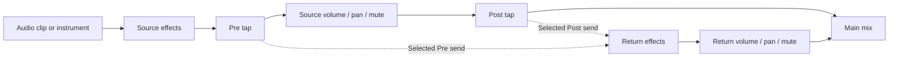

# Halftrack architecture

## Shared application

One C++20 JUCE application runs on macOS, Windows, and Linux. Tracktion owns edit/playback state, graph scheduling, streaming, recording, and rendering. Halftrack owns commands, its interface, project envelope, and built-in DSP. This is an independent implementation with original assets.

`MainComponent` consumes the message-thread-only `Session` facade. Snapshots are value copies for the UI. Position and audio-clip duration use seconds; MIDI note times use beats as specified below. IDs are persisted strings; array indexes are short-lived lookup conveniences, not persistent identity.

## Persistence ownership

The human-readable XML envelope is `<HALFTRACK version="1">`, containing one engine `<EDIT>` tree. Engine state is the single model for track, clip, note, parameter, and undo operations. Built-in synth settings live in its plug-in state. Save flushes engine state, copies it, collects audio into a sibling `<project> Assets` directory, writes a temporary project, then atomically replaces the target. Referenced media paths become relative to the project. MIDI clips do not require external assets.

Runtime media references use absolute paths. Loading resolves portable paths in the candidate edit before it becomes editable; successful save relinks active sources to collected absolute paths without an undo manager. This keeps detached clip trees retained by undo independent of later project-directory changes and preserves musical redo. The separate copy written to disk uses relative paths inside the project-owned Assets folder. A directory relocation changes the runtime absolute string even when the project basename stays the same, so ordinary native listeners refresh cached audio/proxy state; unchanged saves remain no-ops. Arrangement and slot media share this path. Undo history itself is not serialized. Media restored from history is collected into the new project on its next save.

Load parses and validates the envelope into a candidate edit before replacing the active one. Unsupported versions, missing media, and unavailable synchronous external plug-ins produce errors while preserving the active project. Monitoring/arming are reset on load to prevent accidental capture. Unknown asynchronous plug-in failures still need a stronger recovery story; no universal crash-recovery guarantee is made.

Undo/redo uses the engine UndoManager. Continuous UI gestures call `beginEditGesture` / `endEditGesture`; one drag is one undo. Snapshot dirty state combines engine notifications with an explicit user-edit flag because deferred engine initialization can otherwise clear a just-made edit.

## Threads and boundaries

Project commands and editor lifetime stay on JUCE's message thread. The engine supplies its graph update mechanism; this is not described as a blanket lock-free guarantee. Owned DSP accepts direct control changes through preallocated SPSC queues. The separate QA report states the tested and unverified callback paths. File-browser enumeration uses bounded detached filesystem-only workers with shared results; no worker retains a component or JUCE object. The UI polls current results without waiting for blocked filesystem calls.

Offline export constructs/releases the graph on the message thread, executes the render job on a worker, pumps a modal progress interface, and cooperatively cancels. A cancelled render never replaces the destination. Physical-driver timing and arbitrary third-party DSP remain outside automated synthetic-device evidence.

`cmake/PatchRenderLatency.cmake` corrects two pinned offline-render slicing errors: the writer carries the channel view's frame offset into JUCE, and partial-block latency trimming uses the actual number of dropped frames. The controlled VST3 oracle exercises full-window exports with active edges, including 64-frame clips and latency exceeding a processing block. Exact source pins and limitations are in [dependencies](dependencies.md#tracktion-offline-render-latency-patch) and the [regression evidence](research/export-latency-regression.md).

MIDI-device discovery is deferred while any engine context records. The pinned dependency previously cleared active playback contexts during discovery and discarded captured takes. `cmake/PatchTracktion.cmake` adds a message-thread recording guard with a 100 ms retry, covering automatic discovery and explicit rescans without changing the persisted scan interval. Discovery resumes after stop. The synthetic recording regression deliberately crosses the initial four-second scan deadline, requests another rescan during capture, and verifies both retained audio and post-stop discovery. This does not certify physical device removal or every graph rebuild path. See [the exact patch contract](dependencies.md#tracktion-recording-safety-patch).

`Session::isExporting()` stays true until the render worker and graph scopes have released the edit. During this interval, project, track, clip, note, parameter and transport mutations reject or do nothing; undo/redo and recursive export are also blocked. Read-only snapshots and `cancelExport()` remain available. The UI also guards native menus, keyboard dispatch and application close because a modal progress window still pumps native events. This prevents a reentrant command from replacing a graph that the worker is using.

## Platform seams

JUCE provides CoreAudio/AU on macOS, ASIO/system audio on Windows, and the available Linux audio backends. VST3 is shared. CLAP is planned, not enabled. Separate-process plug-in discovery is configured through the engine. The pinned scanner patch synchronizes IPC replies and connection state, stops callbacks before destroying their storage, and refuses to fall back into the host when its child cannot start. See [source pins and tests](dependencies.md#tracktion-scanner-isolation-patch). On Windows, that serialized scanner worker also queries the retained process handle for confirmed exit; coordinator teardown then bypasses a futile shutdown message while preserving disconnect. Alive-worker timeouts and other platforms keep their existing behavior. The test-only observation and notification-suppression seam has no instance state and is excluded without tests. The project format does not translate an AU state into a VST3 or CLAP state.

## MIDI interface

The engine agent maintains this section alongside `src/Session.h`.

- `TrackInfo.isMidi` identifies an instrument track. `TrackInfo.synth` contains `SynthSettings`: cutoffHz, resonance, attackSeconds, decaySeconds, sustain, releaseSeconds, level, pulseWidth (0–1, default 1), and waveform (0 saw, 1 pulse, 2 sine, 3 white noise).
- `ClipInfo.isMidi`, `startBeat`, `lengthBeats`, and `notes` supplement the existing seconds-based arrangement coordinates. A `MidiNoteInfo` contains stable `id`, MIDI `pitch` (0–127), clip-relative `startBeat`, `lengthBeats`, and normalized `velocity` (0–1).
- `addMidiTrack(name)` creates a track and built-in instrument with no clip. `addMidiClip(trackId, startBeat, lengthBeats)` creates an empty musical clip.
- `addMidiNote(clipId, pitch, startBeat, lengthBeats, velocity)`, `updateMidiNote(clipId, noteId, pitch, startBeat, lengthBeats, velocity)`, and `removeMidiNote(clipId, noteId)` edit actual engine notes by persisted IDs. Invalid IDs or out-of-clip notes return an error. Updates support the existing gesture boundary methods for one undo per drag.
- `updateMidiNotes(clipId, notes)` accepts existing `MidiNoteInfo` IDs and requested values. It resolves native IDs once, rejects missing/duplicate/ambiguous targets and validates every requested value before any transaction or mutation. Empty and native-velocity-equivalent batches are no-ops that retain dirty/redo state. Valid changes share one native transaction and one refresh notification, or join an existing gesture. The single-note update delegates to this path. This is a message-thread validation/history guarantee; it does not claim sample-atomic audio publication.
- `addMidiNotes(clipId, notes, insertedIds)` inserts copied values as a group. Input IDs are metadata only: every inserted note gets a fresh ID distinct from existing target IDs and supplied IDs, returned in input order. All values and the existing 100,000-note insertion ceiling are checked first. Failure preserves the output argument, project, dirty state and redo; an empty valid batch clears only the output argument. Single insertion delegates to it.
- `removeMidiNotes(clipId, noteIds)` resolves every target before mutation, rejecting missing, empty, duplicate-request or ambiguous native IDs. Empty valid requests preserve history. Single deletion delegates to it. Both batch methods share one native transaction/notification or join an existing gesture; these guarantees concern validation and message-thread history, not sample-atomic audio publication.
- `setSynthSettings(trackId, settings)` edits the instrument state and participates in undo/redo. Snapshot reads and commands stay on the message thread. MIDI clips follow tempo changes; note durations remain in beats. Existing gain/pan/mute/solo and external effects apply to instrument tracks.

The built-in instrument uses sixteen preallocated voices, band-limited saw/pulse, sine and deterministic white-noise oscillators, a resonant low-pass filter, and an amplitude envelope. Direct parameter packets cross a preallocated SPSC FIFO and are consumed only at audio block boundaries. If the FIFO fills, the producer retains the latest state and retries outside the callback. The synth callback does not access the model, allocate, take locks, or perform I/O. The surrounding dependency graph is audited separately. MIDI keyboard audition remains unexposed. External MIDI-device capture now uses the native input scheduling path described below.

Pulse width maps its normalized value to 0–50% duty; default 1 retains the original square sound. The pulse removes its DC component, with zero width producing zero oscillator input (existing filter/envelope tails still decay). Width is stored even when another waveform is selected; its native control is enabled only for Pulse. Existing version-1 projects missing the field default to 1. Commands reject nonfinite/out-of-range values without an edit, while loading native plug-in state follows the existing finite-clamping/fallback policy. All new fields use the same native undo state and fixed-size FIFO. Parameter edits retain voice histories.

Noise uses an original xorshift32 generator (13/17/5 shifts), one nonzero state per voice, and top-24-bit conversion to [-1, 1). The seed combines note age, pitch and channel; full reset restarts age and reproduces offline renders, while repeated notes and different channels receive distinct seeds. No reference noise sequence or exact sound match is asserted. Independent direct-form filter fixtures cover sine/noise; coherent harmonic tests cover pulse width; full engine exports verify controls, undo and persistence. See [the oscillator contract](research/synth-oscillator-contract.md).

The supported MIDI controller state is channel-local sustain and pitch wheel. CC64 releases pedal-held notes only on a down-to-up transition; repeated pedal-up messages do not restart an existing envelope. CC123 (All Notes Off) follows ordinary note-off release and sustain behavior, whereas CC120 (All Sound Off) clears that channel immediately; neither changes its wheel state. CC121 releases the sustain pedal and centers pitch wheel without cutting held keys or changing patch settings. The host's separate emergency/reset flag clears voices and all supported controller state.

`SubtractiveSynthDSP::pitchWheel(channel, value)` accepts channels 1–16 and values 0–16383, with center 8192. The fixed range is ±2 semitones; separately normalized negative/positive halves reach both endpoints. Sixteen fixed ratios retain the state for subsequent notes. Existing held, sustained and releasing voices change increment while preserving phase, filter, envelope and original note-off identity; frequency remains capped below Nyquist. The native callback applies wheel messages at their rounded sample timestamp, including messages at the end of a processing block. Invalid direct inputs leave state unchanged. No model access, controller allocation or new thread handoff is introduced.

Bend range editing, aftertouch, RPNs, MPE, controller lanes and external MIDI output routing remain separate work. These are explicit synth semantics checked with original PCM fixtures and callback timing tests; no paired reference-device comparison is claimed. The 14-bit wheel, center value and controller numbering follow the [MIDI Association message summary](https://midi.org/summary-of-midi-1-0-messages); the range and endpoint normalization are Halftrack defaults.

## Piano-roll note clipboard

Copy/Cut/Paste/Duplicate use copied note values in an application-local clipboard that survives clip changes. The ruler sets an orange insertion cursor; left/right arrows move it on the grid when no notes are selected. Paste preserves relative geometry, selects exactly the fresh IDs returned by `addMidiNotes`, and advances the cursor by the group extent. Duplicate starts after the selected extent rounded upward to the current grid. Cut and Delete use one validated `removeMidiNotes` call; failed operations preserve notes, selection, cursor and prior clipboard. Paste/duplicate cannot silently trim or extend clips. Focused text editors keep their ordinary commands. Editor selection and insertion position are not musical undo state or project content; new clips reset them, and a shorter current clip clamps the cursor.

## Piano-roll group editing

Selection uses stable note IDs and a separate primary note. Shift-click toggles membership; Shift-drag from empty space adds intersecting notes while ordinary clicks retain drawing. Cmd/Ctrl+A selects the clip's notes and Escape clears. Clip changes clear selection, while same-clip reload/undo prunes missing IDs. Selection is transient editor state. Body drags and arrows apply a common bounded time/pitch delta; right-edge drags apply a common length delta. Existing notes shorter than the normal mouse minimum retain their own shorter floor. Infeasible group intervals leave every note unchanged. Velocity explicitly sets the selected notes to the displayed value.

The editor copies IDs/values before model calls, uses `updateMidiNotes` once per update, and refreshes afterward. The facade rejects an invalid later note without partially changing earlier notes, including accepted loaded-overhang cases. A completed drag, velocity gesture or group deletion is one undoable edit. Physical OS input dispatch remains distinct from component-handler tests and rendered layout checks.

## Reverse-engineering evidence boundary

Research tools live under `scripts/`; they are not linked into the application or invoked on the audio thread. `inspect_macho.py` reads universal/thin arm64 and x86_64 Mach-O metadata with strict bounds checks and records exact hashes, sections, symbol classes and declared function starts. Its fixtures are original synthetic binaries. Named text symbols are candidates, not proven function boundaries. Output files are create-only.

Reference copies, metadata inventories, persistent Ghidra projects and pseudocode stay under ignored `artifacts/reverse-engineering/`; local tool distributions stay under `.deps/reverse-tools/`. Selected static results become independently written behavior hypotheses, then observable tests and original application changes. Analysis coverage, render equivalence and hardware timing are separate evidence. A recovered function count never becomes a completed-feature count. See the [toolchain](research/reverse-engineering-toolchain.md), [vetted skills](research/reverse-engineering-skills.md) and [measurement design](research/behavioral-parity-measurement.md).

## Track mixer normalization and compatibility

New audio/MIDI tracks use the registered `halftrack-mixer` plug-in type, a narrow engine `VolumeAndPanPlugin` subclass. It preserves engine automation, smoothing and fader range, selects the sinusoidal law, then multiplies the first two output channels by sqrt(2) for unity-center normalization. The master retains its existing type. Existing serialized `volume` mixers retain their previous linear law, including after save/reopen; there is no automatic project migration. Mute/solo changes write the engine's state properties through its UndoManager so these edits participate in undo/redo.

The mixer callback's own bounded multiplication is included in the source audit. The inherited engine callback retains the separately documented locking limitation; this is not a whole-host real-time certification. Complete fixture-window render tests include silence and channel isolation; active clip-edge transients require their own comparisons.

`ExportSelectedFunctions.java` is a separate offline Ghidra script: explicit addresses, create-only output directory, finite preparation/decompile timeouts and per-address outcomes. Its outputs are local research evidence, never build inputs to Halftrack.

## Session launcher interface

Empty-slot contract: an empty slot is a scheduled silent takeover of its track, including arrangement-only and completely empty tracks. It uses the same global boundary as a scene's populated cells, then retains ownership across Stop and graph rebuilds until Return to Arrangement. Stop, relocation, project replacement and Return cancel pending silent takeovers. Launches remain transient performance commands; structural undo and portable project contents are unchanged.

The engine agent owns this section and `Session` launcher commands. `Snapshot.scenes` contains ordered `SceneInfo { id, name }` entries. Every `TrackInfo.slots` has the same number/order as the scenes. Each `SlotInfo` has a persistent slot `id`, `hasClip`, a reusable `ClipInfo clip`, and engine-observed `playing`, `queued`, `stopQueued` flags. `playPositionBeats` is the engine-played clip-local loop position, or -1 when inactive/unknown. `TrackInfo.launcherActive` reports launcher ownership of that track. `Snapshot.launchQuantisation` is `Session::LaunchQuantisation::{none,beat,bar}`. New projects begin with eight empty scenes and bar quantisation, without an undo entry or dirty flag. Existing project scene counts are preserved.

All commands return `juce::Result` and run on the message thread: `addScene(name={})`, `removeScene(index)`, `renameScene(index,name)`, `importAudioToSlot(file,trackIndex,sceneIndex)`, `addMidiClipToSlot(trackId,sceneIndex,lengthBeats=4)`, `clearSlot(trackIndex,sceneIndex)`, `launchSlot(trackIndex,sceneIndex)`, `launchScene(sceneIndex)`, `stopLauncherTrack(trackIndex)`, `stopAllLauncherClips()`, `returnToArrangement()`, and `setLaunchQuantisation(value)`. Import/create rejects occupied slots; Clear is an explicit undoable edit. Slot MIDI note edits use existing clip-ID methods and the same piano-roll model. Creating/deleting/renaming scenes, creating/clearing clips, notes, and quantisation are engine undo transactions. Performance launch/stop commands are transient controls rather than structural undo edits.

Slots are native engine clip owners, separate from arrangement clips. Their source media participates in project collection and missing-file validation. Quantised scene launches compute one engine monotonic-beat boundary across tracks; empty cells stop existing session clips and silently take ownership of arrangement-only tracks at that boundary. Launching a clip stops other slots on that track at the same boundary. None starts/stops at the next engine processing opportunity; Beat and Bar use the engine tempo map. If a transport loop wraps before the next grid point, launch at its first contained grid point; if the loop contains none, use its start. Launching from stopped starts the transport immediately. Stop and relocation cancel active and queued launcher handles while preserving track ownership until Return. Looped clips remain in native launcher playback. View changes do not change playback ownership. Return to Arrangement explicitly cancels launcher activity and restores arrangement tracks. Export continues to mean the arrangement; session performance recording/export is separate work.

Scheduling uses Tracktion `LaunchHandle` and graph processing, never a UI timer. `cmake/PatchClipLauncher.cmake` verifies and patches four pinned native source files. A lock-free atomic ownership word on each track retains takeover independently of message-thread publication and graph rebuilds. Its low bit records ownership and upper bits record the Return generation. Audio claims only at a queued launch boundary after native processing reports playing, using compare/exchange against the captured generation; cancellation precedes Return generation changes. Thus an old playing handle cannot reclaim ownership merely because consuming its queued stop was delayed. The message-thread timer publishes the latched state for engine model consumers. MIDI boundary note-offs apply to MIDI-only inputs as well as audio inputs; merged events use the pinned nonallocating stable sort, with note-offs ordered before other events at the same timestamp. A per-track native `LaunchHandle` schedules silent takeover; an actual change in its played start claims ownership through the same generation check. The graph retains a switching node for empty tracks with slots, queued/active silence, or retained ownership, including after all scenes are removed. Return cancels this handle before releasing ownership. The dependency's existing launch command/advance path contains its own synchronization; no blanket lock-free claim is made.

The synthetic-driver suite measures audio boundaries at 120 and 90 BPM, loop wrap, sub-bar loops, stopped transport, repeated audio/MIDI clips, exclusive switching, stopped/returned ownership, graph rebuilds, silent takeover of arrangement-only/source-free tracks, source insertion after takeover, all-scenes removal, cancellation before a boundary, and held-note handoffs including equal pitches. Its delayed-stop test models the old-playing-handle state deterministically; it does not force a native mutex miss. Scene onset alignment is established for serialized command submission. Native per-handle scene enqueue is not an atomic batch: a simultaneous device callback can divide a None scene, or a scene submitted too close to its target, across processing blocks. This concurrency limitation remains open. Native hardware timing, tempo changes during an already queued launch, session recording, per-clip quantisation and follow actions remain unverified or unimplemented.

## Controlled plug-in verification

Test-only plug-in fixtures are original source, built with the application, and never discovered from personal plug-in directories. The gain processor builds as VST3 on all platforms and AUv2 on macOS. The macOS test registers its generated `.component` with `AudioComponentRegister` inside each test process, including the scanner child; it does not install anything into a Components folder. The helper validates bundle identity, component metadata and factory, and retains the loaded bundle while registered. Normal startup has no test registration when its test environment variable is absent; builds without tests omit the helper entirely.

A device-free scanner engine discovers the AUv2 identifier through the real child process. Constructor process IDs prove discovery did not instantiate it inside the host. A separate device-free Session then exercises normal insertion, processing, state save/reopen, bypass, re-enable and removal. Seven stereo 48000-frame renders compare every finite sample, including active clip edges; the initial macOS pass took 6.75 seconds with maximum error 1.19e-7. This establishes the original AUv2 fixture path. AUv3 discovery remains disabled, and arbitrary vendor plug-ins, native AU editor behavior and physical audio deadlines require separate evidence.

## Plug-in editor and asynchronous creation lifecycle

Editor ownership stays on the message thread. The Session command reports a loading/error state instead of opening a blank window. The native window factory also requires a ready processor. Halftrack hosts either its custom editor or JUCE's generic parameter editor, notifies the processor via `editorBeingDeleted` before content destruction, and closes the editor before the engine retires its processor.

The pinned asynchronous lifecycle patch clears failed loading state and refuses to initialize a detached plug-in through the edit's UndoManager. If undo/redo reattaches that cached object, its existing track hook resumes initialization. This preserves redo history and prevents late creation from reopening removed editors. The original nine scenarios also check attached completion against unrelated redo history. Four further deterministic worker scenarios queue the returned processor and error through the JUCE message manager before checking the weak target or touching edit state. Success/failure, undo before delivery and Session destruction before delivery now pass locally; these original fixtures do not establish arbitrary vendor compatibility. Exact pins and teardown evidence appear in [dependencies](dependencies.md#tracktion-asynchronous-plug-in-lifecycle-patch).

## Sends and returns facade

All methods below run on the message thread. `Session::SendMode` is `pre` or `post`.
`addReturnTrack(String name = {})` creates a return at unity gain, center pan and Post;
new projects have no returns. `setTrackSendGain(int sourceTrackIndex, const String&
returnTrackId, float decibels)` accepts finite -100 through 0 dB, with -100 meaning
exact Off. `setReturnSendMode(const String& returnTrackId, SendMode)` changes the tap
for every source feeding that return. Destination identity is the native stable
track ID; renaming and list position never retarget a send.

`TrackInfo::isReturn` identifies returns without changing existing track indices.
`TrackInfo::sendMode` describes a return's destination-wide tap. Ordinary tracks
report `TrackInfo::sends` in return-track order, each `SendInfo` containing
`returnTrackId` and `gainDb`; an absent native send is reported as Off. Returns
report no outgoing sends. Existing track gain, pan, mute, solo, rename, plug-in and
remove methods apply to returns. Recording, input assignment and clip operations
reject returns; scene launches and launcher stop-all skip them.

A return is a native AudioTrack with `halftrackReturn`, `halftrackReturnBus` and
`halftrackReturnSendMode` properties and one first-position AuxReturnPlugin. Its
signal order is return input, external effects, track mixer, meter. Ordinary
tracks use instrument, external effects, Pre sends, track mixer, Post sends,
meter. Each lazily created native AuxSendPlugin retains its own ID and records
`halftrackSendReturnID` plus the matching native bus. Surviving bus identities do
not change when another return is removed. Return deletion also deletes its sends
in the same engine undo transaction; mode changes move existing sends around the
mixer, preserving identity and gain. Gesture boundaries group level edits. `cmake/PatchEditSort.cmake` exposes narrowly scoped native pending-sort delivery; Session drains root/subtrack TrackLists and track/slot ClipOwners before a new transaction, after mutations and before a gesture closes. This retains native undo actions inside the initiating edit, including when an export later dispatches the message loop. No general message pumping is added.

Pre taps follow source effects and precede source volume, pan and explicit mute;
Post taps follow those controls. The source remains dry-muted in either case.
Return solo retains incoming feeds, and ordinary-track solo retains its return
effects. For combined solos, a feed is selected when no track is soloed, its
source is soloed, or its return is soloed; explicit source mute then suppresses
Post feeds only. Every return output stays audible when any ordinary track is soloed, preserving existing effect tails even without a current feed.
This combined-solo rule is a documented Halftrack default, not measured reference
parity. Return mute silences that return's output. Return-origin sends, feedback,
return-to-return routes and alternate hardware outputs are not exposed.

The native engine processes muted source content so Pre sends and return solo
remain audible; this costs CPU for muted instruments and effects. Derived send
enabled states and return solo-isolation states are recomputed on the message
thread after routing, mute/solo, load and undo/redo, using non-undoable native state
writes and supported graph rebuilding. They do not change the user's send level
or run model traversal in the audio callback. Engine callbacks retain the
separately documented dependency real-time limitations.

Version-1 projects persist the native route tree. Canonical nonzero route/slot identities, track identity collisions, bus, gain,
mode, plug-in order, return clip restrictions, input aliases and unsupported
main-output/virtual-input back-routing are checked before
constructing a candidate Edit. Invalid loads preserve the active edit and undo
history. The standalone send/return acceptance suite uses original generated PCM
and plug-ins to verify full-window finite output, independent mix/pan formulas,
undo, portable reopening, malformed routing, and compensated aux paths. Runtime
verification results are recorded in progress when that suite has run.

The selected tap is shared by all sources feeding a given return. The arrows below show the available signal paths; each send uses either Pre or Post.

## CLAP adapter decision

CLAP remains unimplemented. The [pinned-source investigation](research/clap-hosting-path.md) found that the suggested JUCE extension library creates plug-ins but does not host them. The planned native-format adapter must register with both the parent engine manager and the separate scanner-child manager; parent-only registration silently misses child discovery. Preserve full module/descriptor identity and use the existing external-processor path. No dependency or advertised capability is added by this decision. Lifecycle, real-time communication, state, native editor, event timing and latency acceptance requirements are documented in the report before implementation.

## Analysis evidence verification

`scripts/verify_decompile_coverage.py` is separate from the application and never opens the analysis project or executes a target. It accepts the full declared-start inventory and ordered coverage/selection pairs. Each run must match its exact immutable selection hash, recorded program hash and architecture; its database address order must match that selection, which must be a subset of the full inventory. Each read-only transaction freezes indexed rows and closes before file hashing, allowing the coordinator to continue without holding a reader throughout the audit. A hash of the frozen rows identifies each snapshot; unindexed batches remain explicitly excluded.

Every completed file is checked for a canonical name, regular nonsymlink path, nonzero size and recorded SHA-256, including duplicate successes across runs. Combined coverage counts each declared address once: any verified completion wins; otherwise the last attempted outcome in the supplied run order applies. Unattempted later selections do not erase earlier evidence. Per-run counts and identities remain available, so a later failure cannot hide behind aggregate success. Reports are create-only local artifacts. This establishes indexed extraction integrity, not valid semantic boundaries, recovered original source or measured product equivalence.

Instruction-model experiments also remain outside the application. Each analysis pass records the exact compiled language-model hash; concurrently running passes use distinct tool copies. A modified model must pass independent synthetic register/memory fixtures before its recovery outputs enter a combined integrity audit. Original native processor fixtures execute only their own generated instructions. Copied-project fingerprints and pre/post input hashes preserve the original evidence. The [residual-recovery report](research/residual-extraction-recovery.md) states the tested instruction forms and limits; a successful output is never treated as a compiled Halftrack feature or a semantic-equivalence proof.

Analysis output limits and rewrite options are recorded per run, separately from instruction models and application behavior. The latest isolated exporter can omit the unused syntax-tree response and allow up to 256 MiB while retaining C output; its local runner explicitly permits a 300-second function bound and 330-second process deadline. One diagnosed invalid type-size case disables only the optional `concatleftshift` rewrite, preserving its underlying operations. All original failures remain indexed. The aggregate verifier accepts differing recorded exporter fingerprints but still enforces exact target identity, inventory coverage and every completed output hash. None of these tool options enter the audio application or establish DSP equivalence.

## Channel utility interface

`Session::UtilitySettings` is the value packet for an insertable owned stereo device. `addUtility(trackIndex)` creates it before send taps/mixer; `setUtilitySettings(pluginId, settings)` validates the whole packet before one engine undo transaction. `PluginInfo` carries its kind and current settings. Native controls consume this facade using persistent device IDs. The plugin stores properties in its existing engine tree; invalid owned-device state must fail before project replacement. The audio processor receives parameter packets only through its fixed SPSC FIFO. Offline export drains playback before refreshing the FIFO; model/UI work stays on the message thread.

`movePlugin(trackIndex, pluginIndex, destinationIndex)` reorders visible insert effects through the engine's existing undo manager. Instrument, return input, send taps and mixer nodes retain their roles. The utility appears in the same device list as hosted effects and uses the native plugin-window lifecycle; its editor resolves a persistent plugin ID after undo and disables itself when the device disappears.

The allocation-free stereo processor uses original mid/side algebra, a unity-center constant-power balance law, a third-order Butterworth crossover for bass mono, and a two-pole DC blocker. Coefficients and ramp state are fixed storage. Input selection and polarity feed unweighted mid/side filter history; changing width or switching to mono therefore cannot expose an old filtered side tail after the five-millisecond weight ramp. DC precedes the final mute ramp. These choices have independent mathematical tests but are not measured reference DSP equivalence. See [the device contract](research/channel-utility-contract.md).

## Native effects interface

`Session::EffectKind` identifies the eight-band equalizer, compressor, stereo delay and room reverb. `addNativeEffect(track, kind)` inserts before sends/mixer, after instrument/return input and existing inserts. `setNativeEffectSettings(stablePluginId, packet)` validates all values and rejects kind changes before an undo transaction. Snapshots expose `isNativeEffect` and `effect`; UI controls use this facade. The fixed 34-value packet is indexed by `effectParameters(kind)`, whose immutable metadata supplies named XML keys, bounds, labels and default values. Unused values must be zero. This shared packet serves these four implemented devices; it is not a third-party plugin format.

`NativeEffectPlugin` registers one engine type with an immutable serialized kind. The editor and saved model use named properties; audio consumes complete packets through `EffectParameterQueue`, never the model tree. Buffers allocate in preparation and reset in place. Delay/reverb declare tails, and export explicitly refreshes their queues only after draining playback. Automatic tail estimates are conservative maxima; explicit export tail duration remains the user's choice. Native editor lifecycle follows stable device identity. DSP algorithms, defaults, known gaps and independent oracles are documented in [the effects contract](research/native-effects-contract.md).

Tempo-synced delay extends `EffectSettings` with derived `tempoBpm`; device serialization still stores only named control values. The message-thread timer publishes project-tempo changes at 30 Hz. `setNativeEffectSettings` compares actual control values, so stale derived tempo cannot create an edit or override the transport. Export refreshes the derived tempo before graph rendering. Eleven rhythmic ratios fit a preallocated 12-second delay at the supported minimum of 20 BPM. This is bounded parameter synchronization, not sample-accurate tempo-map automation.

## MIDI transformations

`transformMidiNotes(clipId, noteIds, operation, gridBeats)` operates on stable note IDs in arrangement or Session clips. It resolves the whole selection and computes proposed note values before calling the existing `updateMidiNotes` batch validator. One native undo transaction changes the complete group; invalid IDs, bounds, grids, or a too-large stretch preserve notes and history. Empty API selection is a no-op. The piano-roll Note tools menu and Cmd/Ctrl+U deliberately select all clip notes when the UI selection is empty. Cmd/Ctrl+Shift+U quantizes endings.

Starts quantize to the nearest grid with ties later; duration stays unchanged and the result is constrained to the clip. End quantization preserves starts and the model's 1/960-beat minimum. Reverse reflects complete note intervals inside the selected time extent. Pitch inversion reflects around the selected lowest/highest pitches. Legato extends each note to the next distinct selected onset, or the selected end for the last chord. Half/double time scales starts and durations around the earliest selected onset. Fixed length uses the editor's chosen note length, bounded by the clip end. IDs and velocity remain unchanged. These are documented deterministic defaults, not measured numerical reference parity.

## Audio clip editing interface

`ClipInfo` carries `isAudio`, `audio` (gain, fade durations and curve types), source length and `canEditAudioRange` / `canEditAudioFades`. Stable clip IDs resolve both arrangement and Session clips for `setAudioClipSettings`. Values validate before the native undo transaction; explicit manual fades disable automatic crossfade. The engine owns graph updates and clip-level DSP; this does not introduce another audio thread or claim its internals meet the stricter owned-callback contract. Invalid serialized gain/fade data rejects before constructing a candidate edit.

`setAudioClipRange(id, startSeconds, lengthSeconds, offsetSeconds)` edits unwarped, unlooped, normal-speed arrangement audio non-destructively after validating source bounds and retained fades. `splitAudioClip(id, atSeconds, rightId)` and `duplicateAudioClip(id, duplicateId)` use native copy/split operations and one undo transaction; result IDs change only on success. Slot structure is rejected. Split boundaries avoid existing fades and require 2 ms each side. Duplication shares immutable source media and places the copy at the original end. No UI code mutates engine trees directly.

Native source inspection confirms the launcher graph omits the Arrangement fade node. Halftrack therefore disables and rejects manual slot fade edits; Session gain has an actual playback test. Arrangement fades and the separate reference Session edge-fade toggle are distinct workflows; that toggle remains unimplemented.

`cmake/PatchClipGain.cmake` initializes resampler gain from the clip level before the stretch-reader constructor primes its buffers. Its exact pinned input/output checks preserve dependency notices and reject unrecognized sources. The new graph-start regression prevents a saved attenuated clip from briefly starting at unity. The complete parameter, source-ownership and verification boundary is in the [audio-editing contract](research/audio-clip-editing-contract.md).

The Arrangement canvas paints the selected audio clip's native fade curves and exposes two duration handles. Gestures carry a stable clip ID, read current settings and call `setAudioClipSettings`; they never mutate audio buffers or the model tree. Disappearing clips cause the gesture update to do nothing. One native gesture groups intermediate updates. Cmd/Ctrl+E and Cmd/Ctrl+D route only selected Arrangement audio through the same split/duplicate commands, with focused text editors excluded.

## Arrangement audio clipboard

`copyAudioClip(stableId, cut)` retains a detached native state plus an independently copied temporary source file. Supported clips are unwarped, unlooped, ungrouped, normal-speed Arrangement audio with a single source and no take comp. Copy does not mark the edit dirty or modify undo. Cut validates and retains media first, then removes the clip in one native transaction; failed copies leave the prior clipboard intact. Clipboard state survives new/open project operations within the same Session object and never uses the system text clipboard. Its temporary file is deleted when replaced or the Session is destroyed. File copying currently runs on the message thread; very large sources can pause the UI.

`pasteAudioClip(stableTrackId, startSeconds, outId)` accepts ordinary audio tracks only. It first validates the destination and copies the retained source into the current project's Assets folder. `ClipCopy::withNewItemID` remaps native identities, including automation modifier identities; `insertClipCopy` preserves existing properties without applying fresh-clip defaults. One undo transaction inserts the copy without removing overlapping clips. It publishes the new ID only on success. The pasted clip never references the clipboard temporary file, so clipboard replacement, project relocation and undo-retained clips remain independent. Multi-source comping and multi-clip/time-range clipboard are not implemented.

Arrangement Cmd/Ctrl+C/X/V and context commands call this facade. Paste uses the selected audio track and playhead, selects the created clip, and preserves timeline position. An empty-space context menu captures the target track and clicked time. Text-entry focus, piano-roll notes and Session slots retain their own command contexts.

Selected Arrangement audio has direct left/right trim targets, separated visually from its fade handles. Left trim shifts start and source offset together while retaining the end. Right trim retains start and offset. Both clamp to available source audio and the greater of one millisecond or the sum of manual fade lengths. Edges snap in timeline seconds using the existing adaptive grid; Alt bypasses snapping. Shift+Alt-body drag slips the source in the opposite direction while holding the timeline range fixed. Every drag groups native edits into one undo transaction. Gesture events resolve the persistent clip ID from a fresh Session snapshot, including ordinary body moves; replacement at the same array index cannot redirect an in-progress drag. These gestures call `setAudioClipRange` rather than implementing another playback path.

`moveAudioClip(stableClipId, stableDestinationTrackId, startSeconds)` moves an ungrouped Arrangement audio clip between ordinary audio tracks without replacing its native identity or media. It rejects slot clips, MIDI/return/frozen destinations, recording/export activity and positions whose complete clip exceeds the engine's 48-hour timeline. Parent change and time movement share one native undo transaction. Body dragging resolves current ownership on every event and selects the persistent identity after native sorting. MIDI body dragging uses the corresponding typed move method described below. Numeric audio range, clipboard paste, duplicate and ordinary clip movement also reject overflow before native setters can clamp it.

After range changes, Arrangement selection is also resolved by clip identity. Native start-time sorting can change a clip's array index during left trim; the following mouse event and keyboard command must continue to address the edited clip. The production regression trims past a neighboring clip and checks selection plus one-step undo.

## Arrangement locators

`Snapshot::locators` exposes named point locators sorted by time, each with a persistent native item ID and an absolute position in seconds. `addLocator`, `updateLocator` and `removeLocator` use the engine marker track and undo manager. A marker has a 1 ms native storage extent; its visible position is a point. Names contain 1–128 characters without line breaks or tabs, positions fit inside the 48-hour timeline, and a project supports up to 4096 locators. Empty names on Add receive a generated label. Invalid edits and identical updates leave history intact. Project loading rejects invalid positions, non-absolute markers, invalid IDs and duplicate canonical native identities before replacing the active edit.

`seekLocator` and `navigateLocator(forward)` change transport position without dirtying the project. Previous/next excludes positions within 1 ms of the current playhead and does not wrap. Tempo edits leave absolute locators fixed. Export duration derives from playable tracks, so locators beyond the last audio or MIDI clip do not extend the render.

The Arrangement ruler has a separate locator row and Add/Previous/Next controls. Click seeks; double-click edits the name and time; double-click empty locator space adds a marker. Drag uses the timeline grid (Alt bypasses snapping) and one undo gesture. The ruler owns locator keyboard focus, with Delete removing only its selected marker. Every callback resolves a stable identity, including stale drag or editor callbacks. Right-click provides creation, editing, deletion and a named jump list. Shift-drag retains loop editing. Buttons are laid out after the canvas takes its final size, preventing overlap after window resizing. These are production-handler and layout tests; physical mouse delivery remains a separate manual check.

## Non-destructive audio reversal

`ClipInfo::reversed` and `canReverse` describe native direction and the supported control scope. `setAudioClipReversed(stableId, enabled)` validates a readable single source, a complete source region, normal speed/pitch and an ordinary unfrozen Arrangement clip. It rejects recording/export activity, loops, warping, automatic pitch/tempo, comping, groups, Session slots and clip effects/ARA. An identical request leaves document state and undo untouched. The native setter mirrors source offset and direction together in one transaction while retaining placement, gain and fades. Original media is immutable; a native background job creates cached reversed playback. Save As retains original media plus native direction/offset metadata, and reopening regenerates playback as needed.

The audio editor exposes a real Reverse audio toggle. Range, slip, split and clipboard operations retain their forward-only contract until reversal is switched off. Native duplicate retains direction and the exposed source region. The Arrangement waveform uses the immutable source interval in reverse display order, including horizontal viewport clipping; it does not edit sample buffers.

`cmake/PatchReverseChannels.cmake` fixes a reproduced immediate-export/redo silence bug in the pinned engine. Before reversed playback exists, `getWaveInfo()` previously provided zero channels when sources were plain files rather than native project-manager items. Graph construction retained that empty channel layout even after background rendering completed. The exact-source patch uses original-file channel metadata during that interval; reversal preserves the channel layout. The existing engine reader still waits for generated media. No fixed sleep, extra DSP callback or new audio-thread I/O is added.

## Standard MIDI File interchange

`importMidiFile(file, startBeat, outClipIds)` reads PPQ-based type 0/1 files into detached native MIDI lists before mutating the edit. Each source-track/channel pair becomes a new MIDI track with the existing built-in synth and a beat-synchronized Arrangement clip. Channel-independent SysEx is attached once, to the first channel in its source track (channel 1 if there are no channel events). Import retains source-relative event positions, file-track duration, notes, on/off velocities, CC, program changes, pitch bend, polyphonic/channel pressure and SysEx. Notes receive persistent editable IDs. Source file tempo/meter maps do not replace project tempo/meter; events follow the current project tempo. Track names are retained; other text/meta events are not imported.

Validation rejects unsupported time/format types, unmatched note ends, overlapping same-pitch/channel notes and unsupported system messages before creating tracks. Resource bounds are 16 MiB, 100,000 events and 64 resulting tracks per import; the complete placement must fit the native 48-hour timeline and existing beat limit. All new tracks, clips, events and synths share one native undo gesture. MIDI contents are embedded in the project; there is no external MIDI file dependency after import. Parsing is bounded but synchronous on the message thread.

`exportMidiClip(stableClipId, destination)` serializes the selected Arrangement or Session clip's source events to a type 0 file at 9600 PPQ, with the clip name and current project tempo. Export uses edited note values and release velocities, omits muted notes, and retains supported controllers/SysEx on the clip channel. Source event positions are independent of timeline placement; groove, loop repetition, clip offset and tempo maps are not rendered into the file. Times round to ticks, with at least one tick per note; export rejects source extents beyond the standard 28-bit delta bound at that resolution before touching the destination. Equal-time SysEx/controller setup precedes notes. File writing uses a temporary sibling and atomic replacement, with invalid data leaving existing files and undo history intact.

File-menu actions open native choosers. Import completion selects the first new clip in the piano roll. Export captures a persistent clip ID and writes exactly the path for which the native chooser handled overwrite consent; a stale selection cannot redirect it to a replacement clip. Model/render tests and production completion-handler tests are separate from physical native chooser checks.

## Arrangement MIDI clip clipboard

`copyMidiClip(stableId, cut)`, `hasMidiClipClipboard()`, `pasteMidiClip(stableTrackId, startSeconds, outId)` and `duplicateMidiClip(stableId, outId)` operate on complete native MIDI clip trees. The supported range is an unlooped, ungrouped, single-take Arrangement clip at normal speed with zero source offset. `ClipInfo::canEditMidiClip` exposes that scope to the canvas. Cut/duplicate/paste reject recording/export activity and frozen mutation targets. Copy retains a detached tree and beat duration without changing the document; Cut removes only after retaining that tree. Each paste remaps native identities and regenerates every Halftrack note ID before insertion. A duplicate does the same without replacing the clipboard.

Paste converts the retained beat duration through the destination tempo sequence, so copying a two-beat clip from 120 BPM to 180 BPM retains two beats, rather than its former one-second duration. Notes, controller events, release velocities, SysEx and native clip settings stay embedded in the copied state. Paste retains overlapping material. Invalid destinations and bounds reject before beginning an undo transaction; output IDs publish only on success. Each successful Cut/Paste/Duplicate is one undoable musical edit, including identities that remain stable through redo and save/reopen.

The most recent successful audio or MIDI clip copy replaces the other clip type. Failed copies preserve the prior clipboard. MIDI and audio clipboard state survives project changes within the same Session; note-editor and system text clipboards remain independent. In Arrangement, Cmd/Ctrl+C/X/V/D and clip/empty-row context menus route to the typed facade for the target track. Piano-roll shortcuts remain note operations, and focused text editors retain text commands. Successful paste/duplicate selects the new clip by identity. Context deletion also resolves its originally captured identity from the current snapshot, so a changed selection or stale menu cannot delete the clip now occupying an old index.

## Arrangement MIDI movement

`moveMidiClip(stableClipId, stableDestinationTrackId, startSeconds)` reparents an ungrouped Arrangement MIDI clip onto an unfrozen MIDI track through the native engine. It preserves native clip/note identities and all embedded events; the destination track supplies the instrument, effects and mixer, while the source instrument remains on its track. Parent and position changes share one undo transaction. The current constant-tempo project preserves clip duration and source offset; tempo-map movement is not implemented. Recording/export, slot clips, audio/return/frozen targets, stale identities and complete-clip timeline overflow reject before edits. Identical requests preserve a clean document and existing undo history.

Body dragging now selects a compatible MIDI or audio destination row and resolves current ownership by clip identity on every event. Multiple row changes within one drag are one undo gesture. Wrong-type rows do not move the clip, and deletion/replacement during a gesture cannot redirect subsequent events.

## Shared track order

`moveTrack(stableTrackId, destinationIndex)` moves a top-level audio, MIDI or return track to a final zero-based position in the shared track list. It uses the native edit's track move and undo manager, flushes native structural sorting inside the transaction and retains the original track object/state. Clip/device/note/slot IDs, embedded contents, mixer controls and send destination IDs stay with the track. Returns may precede their sources; native bus identities, not visual order, define routing. Recording/export, missing identities, invalid positions and nested-group destinations reject before edits. An identical position is a document/history no-op. Nested track-group reordering is not implemented.

Track-menu Earlier/Later and Arrangement/Session header context menus call this method. Context completion captures track identity and resolves its current index, so a later selection or deletion cannot redirect the operation. All views read the same snapshot order; selection follows its persistent track ID through movement, undo and redo. Shared row synchronization moves existing controls by track identity and updates their index; it does not rebind an open rename editor or fader to a different track. Audio output tests cover dry paths and post sends into a return placed before its sources.

## Whole-track duplication

`duplicateTrack(stableTrackId, outId)` copies an unfrozen top-level audio or MIDI track immediately after its source using the engine's native track copy. Native identity remapping creates independent tracks, devices, clips and Session slots; Halftrack additionally regenerates note IDs in every copied Arrangement/Session MIDI sequence. Device state, synth settings, mixer controls, clip timing and embedded events are retained. Audio clips share immutable project media; normal Save As collects that media into the portable destination. Existing send destinations remain references to the original return buses. Each duplicate is one native undo transaction, and redo restores the same fresh identities.

Copies start with Arrangement ownership and no queued/running Session launch. Input assignments live outside the copied track, so the new track is unassigned, unarmed and unmonitored; the source's capture settings are retained. Recording/export, missing sources, return tracks, frozen sources and nested groups reject before copying. Return duplication needs a separate bus-allocation policy and is not part of this operation. The new ID publishes only on success.

Track-menu and header-context Duplicate actions select the created track. Context callbacks retain the original source identity across selection changes. Model tests include copied native and generated VST3 effects, arithmetic full-buffer signal expectations through shared returns, independent synth/note/device edits, portable saves, undo/redo and generated-device input/Session ownership checks.

## Global tempo consistency

The supported constant project tempo is 20–999 BPM. `setTempo` rejects nonfinite input, clamps finite programmatic requests to those bounds, and returns without changing dirty state or undo if the effective value is unchanged. The native text editor accepts only a complete finite numeric value within the range; invalid text restores the current value without changing history. Project loading validates each serialized tempo's numeric value before constructing or replacing the edit. Tempo maps remain outside the current editor workflow.

`cmake/PatchTempoRange.cmake` raises the exact pinned engine maximum to 999 and reduces its beat-synchronized clip remapping dead zone from 1 ms to 1e-12 seconds. The larger dead zone left clips off beat after small tempo changes and accumulated drift across repeated edits. The native conversion and undo paths remain in use; absolute clips/locators retain their existing behavior. Both source files are validated before either is written, repeat application is supported, and unknown sources reject without partial writes.

Generated tests check clip beat identity and seconds, independently calculated rendered note onset and duration at 20/120/300/300.01/500.5/999 BPM, 100 consecutive small edits, absolute locator placement, saved high tempos, one-step undo and malformed-project preservation. The synchronized delay suite compares full buffers at the newly supported high project tempos; standalone DSP divisions retain their existing independent impulse tests.

## MIDI controller input and recording

`inputNames(midi)` returns typed native inputs; the default argument retains the audio-input API. `setTrackInput` validates the requested name and track type before changing its route. Inputs are exclusive: assigning one to another track removes the previous target. MIDI tracks expose the same input, Off/Auto/In monitoring and arm controls in Arrangement and Session. The recorded destination is the Arrangement track; this does not capture a Session performance.

The host policy leaves newly discovered physical MIDI inputs disabled until selected, retaining previously saved enablement. Selecting All MIDI Ins explicitly enables the currently available physical inputs. A bounded native extension performs the selected enablement/rescan synchronously on the message thread before resolving its input instance, so the first selection works. Tests use `Session(false, syntheticAudioDevice)` and a unique source-free virtual input; the engine behavior excludes physical MIDI enumeration in that mode.

Monitoring Off suppresses input, Auto follows record arm, and In plays an unarmed instrument even while stopped. Arm changes write the native destination's cached value with the edit undo manager. Monitor changes retain a per-track mode in the native state, and undo/redo reapplies that mode to the assigned input. Loading resets both the actual input and stored monitor mode to Off and disarms the target. Input enablement is an application device preference, not an undoable document edit.

`record()` starts the native input capture graph. Repeated Record during a take is a no-op. Stop first starts one native “Record take” transaction, inhibits timer boundaries while native insertion finishes, assigns stable IDs to new MIDI notes and flushes pending structural sorting inside that same transaction. This also fixes redo after native recording insertion. Seeking while recording uses this same finalization before locating. Input reassignment, arm/monitor changes and history operations are unavailable during capture so those commands cannot bypass take finalization. Existing continuous edit gestures end before the take transaction.

Native default MIDI recording is unquantized and merges an overdub into an overlapping clip. Notes, note-on/release velocities, CC including sustain, pitch bend, program changes, channel pressure and poly pressure retain event bytes and timing in the generated single-channel fixture. A held note closes at stop; an empty take adds no clip. `PatchMidiReleaseVelocity.cmake` repairs release-velocity loss in native sequence import using the matched note-off, preserving the existing undo manager and GPL source. Completed notes are immediately editable and survive undo/redo and save/reopen.

The current native non-MPE recording path consolidates received channels into one clip channel. Input channel filters, MPE association, record quantization controls, replacement/take-lane choices, step/retrospective capture, physical latency/hot-plug and external MIDI output remain separate work. Native MIDI graph/capture code has synchronization and dynamic storage; generated tests do not establish whole-host real-time safety. See the exact dependency patches and test scope in [dependencies](dependencies.md#tracktion-midi-recording-and-device-policy-patches).

## Metronome and count-in

`Snapshot::metronome` and `setMetronome` expose enable, first-beat accent, recording-only mode, 20–100% gain and zero/one/two-bar count-in. The current meter is 4/4. Settings are one native undo transaction; unchanged or rejected edits preserve history. Native `CLICKTRACK` state stores click controls. Because the pinned engine stores count-in in an application preference, root `halftrackCountInBars` stores the document value and reapplies it on new/load/undo/redo/record. Load validates all click fields and rejects duplicate click nodes before replacing the active edit.

The transport Click button and its adjacent settings menu call this facade. `Snapshot::countInBeatsRemaining` derives the temporary cue from the native click range, including count-ins at nonzero positions. Count-in adds the engine's half-beat preparation lead, then four/eight clicks before the requested start; it does not require the ongoing metronome toggle. Starting Record during ordinary playback clears a stale cue and records without rewinding. Count-in length cannot change during a take.

Before starting capture, Session flushes pending native destination/arm updates, then dispatches resulting graph updates. Otherwise a queued arm update can stop the new take and re-punch during pre-roll. `PatchInputRecordingState.cmake` exposes that message-thread flush; it adds no callback work. `PatchNegativeTime.cmake` fixes negative graph seconds-to-frame rounding, matching native core time conversion and preserving positive-time behavior. Both patches retain upstream GPL notices and exact source hashes.

The metronome uses the existing native click renderer and licensed dependency samples. Acceptance fixtures substitute generated impulses and compare complete callback buffers against independent beat/accent/gain arithmetic. Recording fixtures use generated audio/controller events, never physical hardware. Export omits the metronome. Cue-output routing, alternate signatures/subdivisions, custom click selection and paired reference/listening checks remain separate work.

The native wave-input first-callback guard waits until a queued transport start has reached the graph. This avoids recording one block mapped at the old playhead location and consuming the initial sample adjustment too soon. Full recorded-file tests use the native following-block input reference, shared with the MIDI timestamp fixtures; they check all frames, early count-in cancellation, later timeline starts and one-take undo. This is generated clock alignment, not physical input/output latency calibration.

## Recording quantization

`Snapshot::recordQuantisation` and `setRecordQuantisation` expose Off, quarter, eighth, eighth-triplet, sixteenth, sixteenth-triplet and thirty-second note grids. Root `halftrackRecordQuantisation` stores the bounded enum (0–6); missing values default to Off. Invalid/nonintegral values fail load before replacing the active project. The Edit menu uses the facade; settings undo once, unchanged values do nothing, and edits during capture/export are rejected.

Recording explicitly disables the native input's remembered quantizer. Stop first finishes native recording, then applies the selected grid only to captured notes that have not yet received Halftrack identities. Existing overdub note identities distinguish earlier material. Snap each new onset on the absolute project beat grid; retain duration/velocity and clamp the onset to the captured clip's available range. Note ends, controllers and other recorded events retain their timing. Copy the native note-pointer list before editing timing, since native order can change. Quantization and identity assignment share the single Record take transaction, so one undo removes the take and redo restores its editable identities. Monitoring remains immediate and unquantized.

Recording quantization currently requires ordinary unlooped, ungrouped, single-take MIDI clips with no source offset and normal speed; loop recording is rejected before capture when quantization is enabled. Raw recording and audio-only loop capture remain available. Other strengths, swing/groove, note-end quantization and quantized loop/offset recording are separate work.

## Master output level

`Snapshot::masterGainDb` and `setMasterGain` expose the native master volume, after all ordinary and return-track contributions. Its range is silence (-100 dB) through +6 dB, with new projects at unity. Finite programmatic values clamp; nonfinite values fail before changes. Compare native normalized fader positions for no-op detection, avoiding float round-trip history entries. A drag is one native undo gesture. The bottom-right vertical fader and numeric entry use this facade; double-click restores unity. Export renders the same master stage. No additional audio callback or DSP is introduced.

Native `MASTERVOLUME` state persists the level. Loading rejects duplicate groups, unexpected/multiple plug-ins and nonfinite/out-of-range normalized volume values before replacing the active edit. Missing legacy state retains the engine default. Independent generated stereo renders compare every output frame for silence, attenuation, unity and +6 dB, including a known return contribution, undo/redo and reopen. Master pan, a master effects chain, dedicated cue routing and reference-exact fader law remain separate work.

The generated audio device has an optional bounded `HALFTRACK_TEST_DISPATCH_MS` stress setting, changing message-dispatch pacing without changing its 48 kHz/256-frame clock. The dedicated MIDI-monitor test runs the production routing/undo path with delayed dispatch and an idle interval, with independent assertions for redo availability, actual mode and output silence. This supplements the complete recording suite; it does not open physical devices.

When a previously monitored MIDI track loses active input through monitor mode, Auto disarming, reassignment or undo/redo, Session flushes pending input/graph updates and injects sustain-off plus All Notes Off for all sixteen channels through the native graph. Instrument release tails remain available; no processor is reset from the message thread. Only tracks crossing from active to inactive receive this release, so unrelated mixer undo does not interrupt notes. This releases that track's MIDI voices rather than claiming per-source/MPE voice isolation. Generated tests cover held/sustained notes, channels 1/16, history, assignment and completely empty tracks. The native injection path retains the dependency's existing synchronization; this does not strengthen the whole-host real-time guarantee.

## Tap tempo

`tapTempo(monotonicSeconds)` accepts message-thread clock timestamps. The first tap anchors without editing; later taps estimate tempo from the mean of the latest four accepted intervals. A pause over three seconds starts a new estimate. Intervals faster than 999 BPM are ignored without moving the anchor, while nonfinite, negative or backwards times fail. Accepted estimates stay within 20–999 BPM and use the same native tempo model and beat-synchronized clip remapping. Each changed estimate is a separate undoable tempo edit; unchanged estimates add no history. Manual tempo entry, undo/redo and successful new/load reset the transient estimator. Only the accepted tempo is serialized.

The transport Tap button supplies the monotonic clock and does not start playback. Export rejects taps before modifying estimator or project state. Deterministic timestamps test averaging, outlier bounds, debounce, history and resets; rendered notes verify the actual new beat timing. The UI test invokes the real button callback and bounds its timestamp using the surrounding clock reads. Physical rhythmic input and reference tap-estimator matching remain unverified.

## Clip activation

`ClipInfo::active` reports the inverse of the native clip mute field. `setClipActive(clipId, active)` finds a stable audio/MIDI identity across Arrangement and Session slots, rejects missing/ambiguous IDs and frozen tracks, and changes native mute in one undo transaction. Equal values are no-ops. Export rejects edits. No musical events, media, position, loop, or launch ownership are deleted. Version-1 projects retain the native `mute` field; absent means enabled and present values must be 0 or 1. Malformed loads retain the active edit and redo.

Arrangement and Session context menus expose Activate/Deactivate; unmodified **0** toggles the selected clip outside Piano Roll and text editors. Inactive clips use a desaturated fill and `OFF /` label. Deferred menus resolve their captured clip identity, including when selection changes or a slot is replaced.

The facade requests a native message-thread graph update on activation changes. Undo/redo compares surviving clip states and requests the same update only when activation changed. The exact-source activation patch invalidates prepared wave readers when mute changes, preserves the seconds-based MIDI node's source identity and atomic mute-transition state, and releases inherited active notes in the looping MIDI node. Existing release/effect tails are allowed; deactivation is not a hard downstream effect bypass. Re-enabled Session clips resume their future events without a new launch; chasing every held controller/MPE state is not established. The native buffer and graph paths keep their separately documented real-time limitations.

Generated tests compare complete offline audio/MIDI renders, undo/redo, duplicate and save/reopen, then use the actual hosted driver for timeline/Session activation while sounding. Independent instrument tracks, repeated transitions, retained launch ownership, invalid loads, export reentrancy and native UI dispatch have dedicated coverage. Physical input and sample-exact reference transition timing are separate manual/measurement work.

## Piano-roll note splitting

`splitMidiNotes(clipId, noteIds, splitBeat, insertedIds)` splits only selected notes whose interiors cross the clip-relative marker. Every identity, split duration and note-count bound is validated before changing any native state. Empty selections and exact note edges are no-ops; sub-minimum fragments, invalid IDs, frozen tracks and notes carrying expression children reject the complete request. Failure preserves the output argument and history. A successful no-op clears the returned IDs without dirtying the project.

The original note keeps its identity as the left half. A native note copy forms the right half with a fresh ID, retaining release velocity, colour, mute and additional ordinary properties. Both halves share one native undo transaction; returned right IDs follow the input selection order. Splitting intentionally creates another note onset at the marker, so envelopes can retrigger. It is not intended to preserve the unsplit waveform. Expression envelopes need a separate time-remapping implementation and are never silently discarded.

Cmd/Ctrl+E and **Note tools → Split Notes at Marker** apply to the selected notes, or all crossing notes if no note is selected. The new right halves become selected. Both Arrangement and Session piano rolls use the same command; the ruler remains clip-relative and Session marker changes do not seek Arrangement. Text input keeps its shortcuts, export guards reject mutations, and delayed menu actions cannot follow a changed clip, selection or marker. Generated tests compare the complete audio against independently drawn split notes, plus identity, native properties, one-step history, atomic rejection, project reopening and actual key/mouse handlers.

## Clip display names

`renameClip(clipId, name)` resolves a unique stable audio/MIDI clip identity in Arrangement or Session, trims surrounding whitespace and rejects blank names before changing state. Equal normalized names are no-ops. The native `name` property uses the edit UndoManager for one-step undo; MIDI events, source files, clip geometry, activation and launch ownership are retained. Editing the property directly intentionally bypasses the engine's optional source-file-renaming preference. Display names, including Unicode and XML punctuation, round-trip through the existing version-1 project format. Export rejects the operation.

Both clip context menus and Cmd/Ctrl+R outside Piano Roll/text editors open the original Halftrack rename dialog. The asynchronous confirmation captures the original clip ID; changing selection or replacing a slot cannot retarget it. Cancel makes no edit. The model tests cover all four audio/MIDI × Arrangement/Session cases, exact source bytes and path retention, native history, portable reopen, stale IDs, blank input and no-op dirty state. Production UI tests open and resolve the actual modal dialog, including selection changes, undo, cancellation and a removed target.

## Session scene duplication

`duplicateScene(stableSceneId, outId)` inserts a native scene directly after the source, with a fresh scene ID and a name ending in ` copy`. Every track, including returns, gains a corresponding empty slot; populated ordinary audio/MIDI slots then receive native clip copies. Native IDs and Halftrack note IDs are regenerated while source media, names, gain, activation, looping and musical events are retained. Copies share immutable media and Save As collects the referenced files normally. The operation uses one edit undo transaction; redo restores the same copied identities.

The existing playing/queued handles belong to the original clips and are not transferred. Copying does not launch the new scene, reassign inputs or stop the source. Missing/ambiguous scene IDs, an incomplete slot row, unsupported/frozen populated tracks, recording/export and the 256-scene ceiling reject before mutation and do not change the caller's output ID. UI Session-menu and scene-context actions capture stable identity and select/scroll to the new row on success.

Generated native-driver tests check source sound before and after copying, copied audio/MIDI playback, retained muted clips, row ordering, fresh identities, independent note edits, one-step history, portable reopening, source deletion, empty rows and ceiling rejection. The test sources are registered before any operation that can prepare audio readers, so accelerated callbacks do not depend on asynchronous disk-cache timing.

## Session scene ordering

`moveScene(stableSceneId, destinationIndex)` moves an existing scene to a zero-based final row through the engine SceneList. Every track's corresponding slot moves with it, including empty and return rows. Scene/slot/clip/note identities, contents and active launch handles remain unchanged. There is one native undo step; moving to the current row is a clean no-op. Missing/ambiguous IDs, out-of-range destinations, incomplete rows, recording and export reject before mutation.

Session-menu and scene-context Up/Down actions resolve captured identity against current rows. Selection and the open clip editor retain their stable IDs while the view scrolls to the selected scene. Generated native-driver tests move sounding and queued scenes and check actual output across the pending quantization boundary, plus every row's IDs, both move directions, undo/redo, no-ops, failed-command history and save/reopen.
