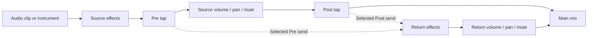

# Halftrack architecture

## Shared application

One C++20 JUCE application runs on macOS, Windows, and Linux. Tracktion owns edit/playback state, graph scheduling, streaming, recording, and rendering. Halftrack owns commands, its interface, project envelope, and built-in DSP. This is an independent implementation with original assets.

`MainComponent` consumes the message-thread-only `Session` facade. Snapshots are value copies for the UI. Position and audio-clip duration use seconds; MIDI note times use beats as specified below. IDs are persisted strings; array indexes are short-lived lookup conveniences, not persistent identity.

## Persistence ownership

The human-readable XML envelope is `<HALFTRACK version="1">`, containing one engine `<EDIT>` tree. Engine state is the single model for track, clip, note, parameter, and undo operations. Built-in synth settings live in its plug-in state. Save flushes engine state, copies it, collects audio into a sibling `<project> Assets` directory, writes a temporary project, then atomically replaces the target. Referenced media paths become relative to the project. MIDI clips do not require external assets.

Runtime media references use absolute paths. Loading resolves portable paths in the candidate edit before it becomes editable; successful save relinks active sources to collected absolute paths without an undo manager. This keeps detached clip trees retained by undo independent of later project-directory changes and preserves musical redo. The separate copy written to disk uses relative paths inside the project-owned Assets folder. A directory relocation changes the runtime absolute string even when the project basename stays the same, so ordinary native listeners refresh cached audio/proxy state; unchanged saves remain no-ops. Arrangement and slot media share this path. Undo history itself is not serialized. Media restored from history is collected into the new project on its next save.

Load parses and validates the envelope into a candidate edit before replacing the active one. Unsupported versions, missing media, and unavailable synchronous external plug-ins produce errors while preserving the active project. Monitoring/arming are reset on load to prevent accidental capture. Unknown asynchronous plug-in failures still need a stronger recovery story; no universal crash-recovery guarantee is made.

Undo/redo uses the engine UndoManager. Continuous UI gestures call `beginEditGesture` / `endEditGesture`; one drag is one undo. Snapshot dirty state combines engine notifications with an explicit user-edit flag because deferred engine initialization can otherwise clear a just-made edit.

## Threads and boundaries

Project commands and editor lifetime stay on JUCE's message thread. The engine supplies its graph update mechanism; this is not described as a blanket lock-free guarantee. Owned DSP accepts direct control changes through preallocated SPSC queues. The separate QA report states the tested and unverified callback paths. File-browser enumeration uses bounded detached filesystem-only workers with shared results; no worker retains a component or JUCE object. The UI polls current results without waiting for blocked filesystem calls.

Offline export constructs/releases the graph on the message thread, executes the render job on a worker, pumps a modal progress interface, and cooperatively cancels. A cancelled render never replaces the destination. Physical-driver timing and arbitrary third-party DSP remain outside automated synthetic-device evidence.

`cmake/PatchRenderLatency.cmake` corrects two pinned offline-render slicing errors: the writer carries the channel view's frame offset into JUCE, and partial-block latency trimming uses the actual number of dropped frames. The controlled VST3 oracle exercises full-window exports with active edges, including 64-frame clips and latency exceeding a processing block. Exact source pins and limitations are in [dependencies](dependencies.md#tracktion-offline-render-latency-patch) and the [regression evidence](research/export-latency-regression.md).

MIDI-device discovery is deferred while any engine context records. The pinned dependency previously cleared active playback contexts during discovery and discarded captured takes. `cmake/PatchTracktion.cmake` adds a message-thread recording guard with a 100 ms retry, covering automatic discovery and explicit rescans without changing the persisted scan interval. Discovery resumes after stop. The synthetic recording regression deliberately crosses the initial four-second scan deadline, requests another rescan during capture, and verifies both retained audio and post-stop discovery. This does not certify physical device removal or every graph rebuild path. See [the exact patch contract](dependencies.md#tracktion-recording-safety-patch).

`Session::isExporting()` stays true until the render worker and graph scopes have released the edit. During this interval, project, track, clip, note, parameter and transport mutations reject or do nothing; undo/redo and recursive export are also blocked. Read-only snapshots and `cancelExport()` remain available. The UI also guards native menus, keyboard dispatch and application close because a modal progress window still pumps native events. This prevents a reentrant command from replacing a graph that the worker is using.

## Platform seams

JUCE provides CoreAudio/AU on macOS, ASIO/system audio on Windows, and the available Linux audio backends. VST3 is shared. CLAP is planned, not enabled. Separate-process plug-in discovery is configured through the engine. The pinned scanner patch synchronizes IPC replies and connection state, stops callbacks before destroying their storage, and refuses to fall back into the host when its child cannot start. See [source pins and tests](dependencies.md#tracktion-scanner-isolation-patch). On Windows, that serialized scanner worker also queries the retained process handle for confirmed exit; coordinator teardown then bypasses a futile shutdown message while preserving disconnect. Alive-worker timeouts and other platforms keep their existing behavior. The test-only observation and notification-suppression seam has no instance state and is excluded without tests. The project format does not translate an AU state into a VST3 or CLAP state.

## MIDI interface

The engine agent maintains this section alongside `src/Session.h`.

- `TrackInfo.isMidi` identifies an instrument track. `TrackInfo.synth` contains `SynthSettings`: cutoffHz, resonance, attackSeconds, decaySeconds, sustain, releaseSeconds, level, pulseWidth (0–1, default 1), and waveform (0 saw, 1 pulse, 2 sine, 3 white noise).
- `ClipInfo.isMidi`, `startBeat`, `lengthBeats`, and `notes` supplement the existing seconds-based arrangement coordinates. A `MidiNoteInfo` contains stable `id`, MIDI `pitch` (0–127), clip-relative `startBeat`, `lengthBeats`, and normalized `velocity` (0–1).
- `addMidiTrack(name)` creates a track and built-in instrument with no clip. `addMidiClip(trackId, startBeat, lengthBeats)` creates an empty musical clip.
- `addMidiNote(clipId, pitch, startBeat, lengthBeats, velocity)`, `updateMidiNote(clipId, noteId, pitch, startBeat, lengthBeats, velocity)`, and `removeMidiNote(clipId, noteId)` edit actual engine notes by persisted IDs. Invalid IDs or out-of-clip notes return an error. Updates support the existing gesture boundary methods for one undo per drag.
- `updateMidiNotes(clipId, notes)` accepts existing `MidiNoteInfo` IDs and requested values. It resolves native IDs once, rejects missing/duplicate/ambiguous targets and validates every requested value before any transaction or mutation. Empty and native-velocity-equivalent batches are no-ops that retain dirty/redo state. Valid changes share one native transaction and one refresh notification, or join an existing gesture. The single-note update delegates to this path. This is a message-thread validation/history guarantee; it does not claim sample-atomic audio publication.
- `addMidiNotes(clipId, notes, insertedIds)` inserts copied values as a group. Input IDs are metadata only: every inserted note gets a fresh ID distinct from existing target IDs and supplied IDs, returned in input order. All values and the existing 100,000-note insertion ceiling are checked first. Failure preserves the output argument, project, dirty state and redo; an empty valid batch clears only the output argument. Single insertion delegates to it.
- `removeMidiNotes(clipId, noteIds)` resolves every target before mutation, rejecting missing, empty, duplicate-request or ambiguous native IDs. Empty valid requests preserve history. Single deletion delegates to it. Both batch methods share one native transaction/notification or join an existing gesture; these guarantees concern validation and message-thread history, not sample-atomic audio publication.
- `setSynthSettings(trackId, settings)` edits the instrument state and participates in undo/redo. Snapshot reads and commands stay on the message thread. MIDI clips follow tempo changes; note durations remain in beats. Existing gain/pan/mute/solo and external effects apply to instrument tracks.

The built-in instrument uses sixteen preallocated voices, band-limited saw/pulse, sine and deterministic white-noise oscillators, a resonant low-pass filter, and an amplitude envelope. Direct parameter packets cross a preallocated SPSC FIFO and are consumed only at audio block boundaries. If the FIFO fills, the producer retains the latest state and retries outside the callback. The synth callback does not access the model, allocate, take locks, or perform I/O. The surrounding dependency graph is audited separately. MIDI keyboard audition and external MIDI-device capture are not exposed until their real scheduling paths exist.

Pulse width maps its normalized value to 0–50% duty; default 1 retains the original square sound. The pulse removes its DC component, with zero width producing zero oscillator input (existing filter/envelope tails still decay). Width is stored even when another waveform is selected; its native control is enabled only for Pulse. Existing version-1 projects missing the field default to 1. Commands reject nonfinite/out-of-range values without an edit, while loading native plug-in state follows the existing finite-clamping/fallback policy. All new fields use the same native undo state and fixed-size FIFO. Parameter edits retain voice histories.

Noise uses an original xorshift32 generator (13/17/5 shifts), one nonzero state per voice, and top-24-bit conversion to [-1, 1). The seed combines note age, pitch and channel; full reset restarts age and reproduces offline renders, while repeated notes and different channels receive distinct seeds. No reference noise sequence or exact sound match is asserted. Independent direct-form filter fixtures cover sine/noise; coherent harmonic tests cover pulse width; full engine exports verify controls, undo and persistence. See [the oscillator contract](research/synth-oscillator-contract.md).

The supported MIDI controller state is channel-local sustain and pitch wheel. CC64 releases pedal-held notes only on a down-to-up transition; repeated pedal-up messages do not restart an existing envelope. CC123 (All Notes Off) follows ordinary note-off release and sustain behavior, whereas CC120 (All Sound Off) clears that channel immediately; neither changes its wheel state. CC121 releases the sustain pedal and centers pitch wheel without cutting held keys or changing patch settings. The host's separate emergency/reset flag clears voices and all supported controller state.

`SubtractiveSynthDSP::pitchWheel(channel, value)` accepts channels 1–16 and values 0–16383, with center 8192. The fixed range is ±2 semitones; separately normalized negative/positive halves reach both endpoints. Sixteen fixed ratios retain the state for subsequent notes. Existing held, sustained and releasing voices change increment while preserving phase, filter, envelope and original note-off identity; frequency remains capped below Nyquist. The native callback applies wheel messages at their rounded sample timestamp, including messages at the end of a processing block. Invalid direct inputs leave state unchanged. No model access, controller allocation or new thread handoff is introduced.

Bend range editing, aftertouch, RPNs, MPE, controller lanes and external MIDI-device UI remain separate work. These are explicit synth semantics checked with original PCM fixtures and callback timing tests; no paired reference-device comparison is claimed. The 14-bit wheel, center value and controller numbering follow the [MIDI Association message summary](https://midi.org/summary-of-midi-1-0-messages); the range and endpoint normalization are Halftrack defaults.

## Piano-roll note clipboard

Copy/Cut/Paste/Duplicate use copied note values in an application-local clipboard that survives clip changes. The ruler sets an orange insertion cursor; left/right arrows move it on the grid when no notes are selected. Paste preserves relative geometry, selects exactly the fresh IDs returned by `addMidiNotes`, and advances the cursor by the group extent. Duplicate starts after the selected extent rounded upward to the current grid. Cut and Delete use one validated `removeMidiNotes` call; failed operations preserve notes, selection, cursor and prior clipboard. Paste/duplicate cannot silently trim or extend clips. Focused text editors keep their ordinary commands. Editor selection and insertion position are not musical undo state or project content; new clips reset them, and a shorter current clip clamps the cursor.

## Piano-roll group editing

Selection uses stable note IDs and a separate primary note. Shift-click toggles membership; Shift-drag from empty space adds intersecting notes while ordinary clicks retain drawing. Cmd/Ctrl+A selects the clip's notes and Escape clears. Clip changes clear selection, while same-clip reload/undo prunes missing IDs. Selection is transient editor state. Body drags and arrows apply a common bounded time/pitch delta; right-edge drags apply a common length delta. Existing notes shorter than the normal mouse minimum retain their own shorter floor. Infeasible group intervals leave every note unchanged. Velocity explicitly sets the selected notes to the displayed value.

The editor copies IDs/values before model calls, uses `updateMidiNotes` once per update, and refreshes afterward. The facade rejects an invalid later note without partially changing earlier notes, including accepted loaded-overhang cases. A completed drag, velocity gesture or group deletion is one undoable edit. Physical OS input dispatch remains distinct from component-handler tests and rendered layout checks.

## Reverse-engineering evidence boundary

Research tools live under `scripts/`; they are not linked into the application or invoked on the audio thread. `inspect_macho.py` reads universal/thin arm64 and x86_64 Mach-O metadata with strict bounds checks and records exact hashes, sections, symbol classes and declared function starts. Its fixtures are original synthetic binaries. Named text symbols are candidates, not proven function boundaries. Output files are create-only.

Reference copies, metadata inventories, persistent Ghidra projects and pseudocode stay under ignored `artifacts/reverse-engineering/`; local tool distributions stay under `.deps/reverse-tools/`. Selected static results become independently written behavior hypotheses, then observable tests and original application changes. Analysis coverage, render equivalence and hardware timing are separate evidence. A recovered function count never becomes a completed-feature count. See the [toolchain](research/reverse-engineering-toolchain.md), [vetted skills](research/reverse-engineering-skills.md) and [measurement design](research/behavioral-parity-measurement.md).

## Track mixer normalization and compatibility

New audio/MIDI tracks use the registered `halftrack-mixer` plug-in type, a narrow engine `VolumeAndPanPlugin` subclass. It preserves engine automation, smoothing and fader range, selects the sinusoidal law, then multiplies the first two output channels by sqrt(2) for unity-center normalization. The master retains its existing type. Existing serialized `volume` mixers retain their previous linear law, including after save/reopen; there is no automatic project migration. Mute/solo changes write the engine's state properties through its UndoManager so these edits participate in undo/redo.

The mixer callback's own bounded multiplication is included in the source audit. The inherited engine callback retains the separately documented locking limitation; this is not a whole-host real-time certification. Complete fixture-window render tests include silence and channel isolation; active clip-edge transients require their own comparisons.

`ExportSelectedFunctions.java` is a separate offline Ghidra script: explicit addresses, create-only output directory, finite preparation/decompile timeouts and per-address outcomes. Its outputs are local research evidence, never build inputs to Halftrack.

## Session launcher interface

Empty-slot contract: an empty slot is a scheduled silent takeover of its track, including arrangement-only and completely empty tracks. It uses the same global boundary as a scene's populated cells, then retains ownership across Stop and graph rebuilds until Return to Arrangement. Stop, relocation, project replacement and Return cancel pending silent takeovers. Launches remain transient performance commands; structural undo and portable project contents are unchanged.

The engine agent owns this section and `Session` launcher commands. `Snapshot.scenes` contains ordered `SceneInfo { id, name }` entries. Every `TrackInfo.slots` has the same number/order as the scenes. Each `SlotInfo` has a persistent slot `id`, `hasClip`, a reusable `ClipInfo clip`, and engine-observed `playing`, `queued`, `stopQueued` flags. `playPositionBeats` is the engine-played clip-local loop position, or -1 when inactive/unknown. `TrackInfo.launcherActive` reports launcher ownership of that track. `Snapshot.launchQuantisation` is `Session::LaunchQuantisation::{none,beat,bar}`. New projects begin with eight empty scenes and bar quantisation, without an undo entry or dirty flag. Existing project scene counts are preserved.

All commands return `juce::Result` and run on the message thread: `addScene(name={})`, `removeScene(index)`, `renameScene(index,name)`, `importAudioToSlot(file,trackIndex,sceneIndex)`, `addMidiClipToSlot(trackId,sceneIndex,lengthBeats=4)`, `clearSlot(trackIndex,sceneIndex)`, `launchSlot(trackIndex,sceneIndex)`, `launchScene(sceneIndex)`, `stopLauncherTrack(trackIndex)`, `stopAllLauncherClips()`, `returnToArrangement()`, and `setLaunchQuantisation(value)`. Import/create rejects occupied slots; Clear is an explicit undoable edit. Slot MIDI note edits use existing clip-ID methods and the same piano-roll model. Creating/deleting/renaming scenes, creating/clearing clips, notes, and quantisation are engine undo transactions. Performance launch/stop commands are transient controls rather than structural undo edits.

Slots are native engine clip owners, separate from arrangement clips. Their source media participates in project collection and missing-file validation. Quantised scene launches compute one engine monotonic-beat boundary across tracks; empty cells stop existing session clips and silently take ownership of arrangement-only tracks at that boundary. Launching a clip stops other slots on that track at the same boundary. None starts/stops at the next engine processing opportunity; Beat and Bar use the engine tempo map. If a transport loop wraps before the next grid point, launch at its first contained grid point; if the loop contains none, use its start. Launching from stopped starts the transport immediately. Stop and relocation cancel active and queued launcher handles while preserving track ownership until Return. Looped clips remain in native launcher playback. View changes do not change playback ownership. Return to Arrangement explicitly cancels launcher activity and restores arrangement tracks. Export continues to mean the arrangement; session performance recording/export is separate work.

Scheduling uses Tracktion `LaunchHandle` and graph processing, never a UI timer. `cmake/PatchClipLauncher.cmake` verifies and patches four pinned native source files. A lock-free atomic ownership word on each track retains takeover independently of message-thread publication and graph rebuilds. Its low bit records ownership and upper bits record the Return generation. Audio claims only at a queued launch boundary after native processing reports playing, using compare/exchange against the captured generation; cancellation precedes Return generation changes. Thus an old playing handle cannot reclaim ownership merely because consuming its queued stop was delayed. The message-thread timer publishes the latched state for engine model consumers. MIDI boundary note-offs apply to MIDI-only inputs as well as audio inputs; merged events use the pinned nonallocating stable sort, with note-offs ordered before other events at the same timestamp. A per-track native `LaunchHandle` schedules silent takeover; an actual change in its played start claims ownership through the same generation check. The graph retains a switching node for empty tracks with slots, queued/active silence, or retained ownership, including after all scenes are removed. Return cancels this handle before releasing ownership. The dependency's existing launch command/advance path contains its own synchronization; no blanket lock-free claim is made.

The synthetic-driver suite measures audio boundaries at 120 and 90 BPM, loop wrap, sub-bar loops, stopped transport, repeated audio/MIDI clips, exclusive switching, stopped/returned ownership, graph rebuilds, silent takeover of arrangement-only/source-free tracks, source insertion after takeover, all-scenes removal, cancellation before a boundary, and held-note handoffs including equal pitches. Its delayed-stop test models the old-playing-handle state deterministically; it does not force a native mutex miss. Scene onset alignment is established for serialized command submission. Native per-handle scene enqueue is not an atomic batch: a simultaneous device callback can divide a None scene, or a scene submitted too close to its target, across processing blocks. This concurrency limitation remains open. Native hardware timing, tempo changes during an already queued launch, session recording, per-clip quantisation and follow actions remain unverified or unimplemented.

## Controlled plug-in verification

Test-only plug-in fixtures are original source, built with the application, and never discovered from personal plug-in directories. The gain processor builds as VST3 on all platforms and AUv2 on macOS. The macOS test registers its generated `.component` with `AudioComponentRegister` inside each test process, including the scanner child; it does not install anything into a Components folder. The helper validates bundle identity, component metadata and factory, and retains the loaded bundle while registered. Normal startup has no test registration when its test environment variable is absent; builds without tests omit the helper entirely.

A device-free scanner engine discovers the AUv2 identifier through the real child process. Constructor process IDs prove discovery did not instantiate it inside the host. A separate device-free Session then exercises normal insertion, processing, state save/reopen, bypass, re-enable and removal. Seven stereo 48000-frame renders compare every finite sample, including active clip edges; the initial macOS pass took 6.75 seconds with maximum error 1.19e-7. This establishes the original AUv2 fixture path. AUv3 discovery remains disabled, and arbitrary vendor plug-ins, native AU editor behavior and physical audio deadlines require separate evidence.

## Plug-in editor and asynchronous creation lifecycle

Editor ownership stays on the message thread. The Session command reports a loading/error state instead of opening a blank window. The native window factory also requires a ready processor. Halftrack hosts either its custom editor or JUCE's generic parameter editor, notifies the processor via `editorBeingDeleted` before content destruction, and closes the editor before the engine retires its processor.

The pinned asynchronous lifecycle patch clears failed loading state and refuses to initialize a detached plug-in through the edit's UndoManager. If undo/redo reattaches that cached object, its existing track hook resumes initialization. This preserves redo history and prevents late creation from reopening removed editors. The original nine scenarios also check attached completion against unrelated redo history. Four further deterministic worker scenarios queue the returned processor and error through the JUCE message manager before checking the weak target or touching edit state. Success/failure, undo before delivery and Session destruction before delivery now pass locally; these original fixtures do not establish arbitrary vendor compatibility. Exact pins and teardown evidence appear in [dependencies](dependencies.md#tracktion-asynchronous-plug-in-lifecycle-patch).

## Sends and returns facade

All methods below run on the message thread. `Session::SendMode` is `pre` or `post`.
`addReturnTrack(String name = {})` creates a return at unity gain, center pan and Post;
new projects have no returns. `setTrackSendGain(int sourceTrackIndex, const String&
returnTrackId, float decibels)` accepts finite -100 through 0 dB, with -100 meaning
exact Off. `setReturnSendMode(const String& returnTrackId, SendMode)` changes the tap
for every source feeding that return. Destination identity is the native stable
track ID; renaming and list position never retarget a send.

`TrackInfo::isReturn` identifies returns without changing existing track indices.
`TrackInfo::sendMode` describes a return's destination-wide tap. Ordinary tracks
report `TrackInfo::sends` in return-track order, each `SendInfo` containing
`returnTrackId` and `gainDb`; an absent native send is reported as Off. Returns
report no outgoing sends. Existing track gain, pan, mute, solo, rename, plug-in and
remove methods apply to returns. Recording, input assignment and clip operations
reject returns; scene launches and launcher stop-all skip them.

A return is a native AudioTrack with `halftrackReturn`, `halftrackReturnBus` and
`halftrackReturnSendMode` properties and one first-position AuxReturnPlugin. Its
signal order is return input, external effects, track mixer, meter. Ordinary
tracks use instrument, external effects, Pre sends, track mixer, Post sends,
meter. Each lazily created native AuxSendPlugin retains its own ID and records
`halftrackSendReturnID` plus the matching native bus. Surviving bus identities do
not change when another return is removed. Return deletion also deletes its sends
in the same engine undo transaction; mode changes move existing sends around the
mixer, preserving identity and gain. Gesture boundaries group level edits. `cmake/PatchEditSort.cmake` exposes narrowly scoped native pending-sort delivery; Session drains root/subtrack TrackLists and track/slot ClipOwners before a new transaction, after mutations and before a gesture closes. This retains native undo actions inside the initiating edit, including when an export later dispatches the message loop. No general message pumping is added.

Pre taps follow source effects and precede source volume, pan and explicit mute;
Post taps follow those controls. The source remains dry-muted in either case.
Return solo retains incoming feeds, and ordinary-track solo retains its return
effects. For combined solos, a feed is selected when no track is soloed, its
source is soloed, or its return is soloed; explicit source mute then suppresses
Post feeds only. Every return output stays audible when any ordinary track is soloed, preserving existing effect tails even without a current feed.
This combined-solo rule is a documented Halftrack default, not measured reference
parity. Return mute silences that return's output. Return-origin sends, feedback,
return-to-return routes and alternate hardware outputs are not exposed.

The native engine processes muted source content so Pre sends and return solo
remain audible; this costs CPU for muted instruments and effects. Derived send
enabled states and return solo-isolation states are recomputed on the message
thread after routing, mute/solo, load and undo/redo, using non-undoable native state
writes and supported graph rebuilding. They do not change the user's send level
or run model traversal in the audio callback. Engine callbacks retain the
separately documented dependency real-time limitations.

Version-1 projects persist the native route tree. Canonical nonzero route/slot identities, track identity collisions, bus, gain,
mode, plug-in order, return clip restrictions, input aliases and unsupported
main-output/virtual-input back-routing are checked before
constructing a candidate Edit. Invalid loads preserve the active edit and undo
history. The standalone send/return acceptance suite uses original generated PCM
and plug-ins to verify full-window finite output, independent mix/pan formulas,
undo, portable reopening, malformed routing, and compensated aux paths. Runtime
verification results are recorded in progress when that suite has run.

The selected tap is shared by all sources feeding a given return. The arrows below show the available signal paths; each send uses either Pre or Post.

## CLAP adapter decision

CLAP remains unimplemented. The [pinned-source investigation](research/clap-hosting-path.md) found that the suggested JUCE extension library creates plug-ins but does not host them. The planned native-format adapter must register with both the parent engine manager and the separate scanner-child manager; parent-only registration silently misses child discovery. Preserve full module/descriptor identity and use the existing external-processor path. No dependency or advertised capability is added by this decision. Lifecycle, real-time communication, state, native editor, event timing and latency acceptance requirements are documented in the report before implementation.

## Analysis evidence verification

`scripts/verify_decompile_coverage.py` is separate from the application and never opens the analysis project or executes a target. It accepts the full declared-start inventory and ordered coverage/selection pairs. Each run must match its exact immutable selection hash, recorded program hash and architecture; its database address order must match that selection, which must be a subset of the full inventory. Each read-only transaction freezes indexed rows and closes before file hashing, allowing the coordinator to continue without holding a reader throughout the audit. A hash of the frozen rows identifies each snapshot; unindexed batches remain explicitly excluded.

Every completed file is checked for a canonical name, regular nonsymlink path, nonzero size and recorded SHA-256, including duplicate successes across runs. Combined coverage counts each declared address once: any verified completion wins; otherwise the last attempted outcome in the supplied run order applies. Unattempted later selections do not erase earlier evidence. Per-run counts and identities remain available, so a later failure cannot hide behind aggregate success. Reports are create-only local artifacts. This establishes indexed extraction integrity, not valid semantic boundaries, recovered original source or measured product equivalence.

Instruction-model experiments also remain outside the application. Each analysis pass records the exact compiled language-model hash; concurrently running passes use distinct tool copies. A modified model must pass independent synthetic register/memory fixtures before its recovery outputs enter a combined integrity audit. Original native processor fixtures execute only their own generated instructions. Copied-project fingerprints and pre/post input hashes preserve the original evidence. The [residual-recovery report](research/residual-extraction-recovery.md) states the tested instruction forms and limits; a successful output is never treated as a compiled Halftrack feature or a semantic-equivalence proof.

Analysis output limits and rewrite options are recorded per run, separately from instruction models and application behavior. The latest isolated exporter can omit the unused syntax-tree response and allow up to 256 MiB while retaining C output; its local runner explicitly permits a 300-second function bound and 330-second process deadline. One diagnosed invalid type-size case disables only the optional `concatleftshift` rewrite, preserving its underlying operations. All original failures remain indexed. The aggregate verifier accepts differing recorded exporter fingerprints but still enforces exact target identity, inventory coverage and every completed output hash. None of these tool options enter the audio application or establish DSP equivalence.

## Channel utility interface

`Session::UtilitySettings` is the value packet for an insertable owned stereo device. `addUtility(trackIndex)` creates it before send taps/mixer; `setUtilitySettings(pluginId, settings)` validates the whole packet before one engine undo transaction. `PluginInfo` carries its kind and current settings. Native controls consume this facade using persistent device IDs. The plugin stores properties in its existing engine tree; invalid owned-device state must fail before project replacement. The audio processor receives parameter packets only through its fixed SPSC FIFO. Offline export drains playback before refreshing the FIFO; model/UI work stays on the message thread.

`movePlugin(trackIndex, pluginIndex, destinationIndex)` reorders visible insert effects through the engine's existing undo manager. Instrument, return input, send taps and mixer nodes retain their roles. The utility appears in the same device list as hosted effects and uses the native plugin-window lifecycle; its editor resolves a persistent plugin ID after undo and disables itself when the device disappears.

The allocation-free stereo processor uses original mid/side algebra, a unity-center constant-power balance law, a third-order Butterworth crossover for bass mono, and a two-pole DC blocker. Coefficients and ramp state are fixed storage. Input selection and polarity feed unweighted mid/side filter history; changing width or switching to mono therefore cannot expose an old filtered side tail after the five-millisecond weight ramp. DC precedes the final mute ramp. These choices have independent mathematical tests but are not measured reference DSP equivalence. See [the device contract](research/channel-utility-contract.md).
